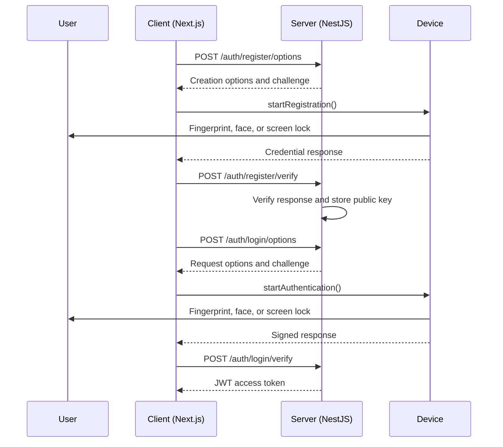

<a name="readme-top"></a>

<div align="center">

# 🔐 Passwordless Auth

**Sign up and sign in with passkeys: your fingerprint, face, or device screen lock. No passwords.**

Built with [WebAuthn](https://webauthn.io/) and
[SimpleWebAuthn](https://simplewebauthn.dev/docs/)

</div>

# 📗 Table of Contents

- [📖 About the Project](#about-project)
  - [🛠 Built With](#built-with)
  - [🔑 Key Features](#key-features)
  - [🧠 How It Works](#how-it-works)
- [💻 Getting Started](#getting-started)
  - [Prerequisites](#prerequisites)
  - [Setup](#setup)
  - [Install](#install)
  - [Usage](#usage)
- [📡 API Endpoints](#api-endpoints)
- [🤝 Contributing](#contributing)
- [⭐️ Show your support](#support)
- [📚 Resources](#resources)

# 📖 Passwordless Auth <a name="about-project"></a>

**Passwordless Auth** is a full-stack passkey authentication demo. Users create
an account with an email address and a passkey, then sign in by verifying with
their device:

| Device | Verification method |
| --- | --- |
| Mac | Touch ID or Mac password |
| iPhone / iPad | Face ID, Touch ID, or passcode |
| Android | Fingerprint, face, or device lock |
| Windows | Windows Hello (face, fingerprint, or PIN) |
| Other devices | Use a phone with a QR code or a security key |

The device handles biometric verification. The server receives a signed
challenge and stores only the passkey's public key; it never receives
biometric data or the private key.

The project is split into two apps:

```text
passwordless-auth/
├── client/   # Next.js frontend (port 3000)
└── server/   # NestJS API and PostgreSQL integration (port 4000)
```

## 🛠 Built With <a name="built-with"></a>

<details>
  <summary>Client</summary>
  <ul>
    <li><a href="https://nextjs.org/">Next.js 16</a> and <a href="https://react.dev/">React 19</a></li>
    <li><a href="https://tailwindcss.com/">Tailwind CSS 4</a></li>
    <li><a href="https://simplewebauthn.dev/docs/packages/browser">@simplewebauthn/browser</a></li>
    <li><a href="https://axios-http.com/">Axios</a></li>
  </ul>
</details>

<details>
  <summary>Server</summary>
  <ul>
    <li><a href="https://nestjs.com/">NestJS 12</a></li>
    <li><a href="https://simplewebauthn.dev/docs/packages/server">@simplewebauthn/server</a></li>
    <li><a href="https://typeorm.io/">TypeORM</a> and <a href="https://www.postgresql.org/">PostgreSQL</a></li>
    <li><a href="https://docs.nestjs.com/security/authentication">Passport JWT authentication</a></li>
  </ul>
</details>

## 🔑 Key Features <a name="key-features"></a>

- **Passkey sign-up and sign-in**: no passwords are created or stored
- **User verification required**: sign-in requires the device's verification
- **Discoverable credentials**: passkeys can be stored and synced by a password manager
- **Cross-device sign-in**: use a phone or a hardware security key
- **Challenge and credential checks**: responses are verified and credentials are tied to their owner
- **JWT-protected API**: authenticator listing requires a signed-in user

<p align="right">(<a href="#readme-top">back to top</a>)</p>

## 🧠 How It Works <a name="how-it-works"></a>

Registration and sign-in use a challenge-response flow. The server creates a
challenge, the device signs it after user verification, and the server checks
the signed response.



The private key stays on the user's device. The server stores the public key
and verifies signatures and the user-verification flag.

<p align="right">(<a href="#readme-top">back to top</a>)</p>

# 💻 Getting Started <a name="getting-started"></a>

### Prerequisites

- [Node.js](https://nodejs.org/) 22 or newer and npm
- [PostgreSQL](https://www.postgresql.org/download/)
- A recent Chrome, Safari, Edge, or Firefox browser
- A passkey-capable device or security key

### Setup

Clone the repository:

```sh
git clone https://github.com/kiarie-ke/passwordless-auth.git
cd passwordless-auth
```

Create a PostgreSQL database named `auth`:

```sh
createdb -h localhost -U postgres auth
```

Alternatively, create the database in pgAdmin.

Create `server/.env`:

```env
JWT_SECRET=replace-with-a-long-random-secret

WEBAUTHN_RP_ID=localhost
WEBAUTHN_ORIGIN=http://localhost:3000

DB_HOST=localhost
DB_PORT=5432
DB_USERNAME=postgres
DB_PASSWORD=your-postgres-password
DB_NAME=auth
```

Create `client/.env`:

```env
NEXT_PUBLIC_API_URL=/api
API_SERVER_URL=http://localhost:4000
```

The client uses a Next.js rewrite to proxy `/api` requests to the backend.
For local passkey testing, open the app at `http://localhost:3000`. The
`WEBAUTHN_RP_ID` is the hostname only; `WEBAUTHN_ORIGIN` includes the scheme
and port. These values must match the browser's actual origin. Other hostnames
or forwarded tunnel URLs require compatible WebAuthn settings and may not be
accepted as an RP ID.

### Install

Install the server dependencies:

```sh
cd server
npm ci
```

In another terminal, install the client dependencies:

```sh
cd client
npm ci
```

### Usage

Start the API in one terminal:

```sh
cd server
npm run start:dev
```

Start the frontend in a second terminal:

```sh
cd client
npm run dev
```

Open [http://localhost:3000/signup](http://localhost:3000/signup), enter your
email, and confirm using your device. Then sign in at
[http://localhost:3000/signin](http://localhost:3000/signin).

<p align="right">(<a href="#readme-top">back to top</a>)</p>

# 📡 API Endpoints <a name="api-endpoints"></a>

| Method | Endpoint | Description | Authentication |
| --- | --- | --- | --- |
| `POST` | `/auth/register/options` | Get passkey creation options | — |
| `POST` | `/auth/register/verify` | Verify and save a new passkey | — |
| `POST` | `/auth/login/options` | Get passkey sign-in options | — |
| `POST` | `/auth/login/verify` | Verify a sign-in and return a JWT | — |
| `GET` | `/auth/authenticators` | List the signed-in user's passkeys | Bearer JWT |

<p align="right">(<a href="#readme-top">back to top</a>)</p>

# 🤝 Contributing <a name="contributing"></a>

Contributions, issues, and feature requests are welcome. See the
[repository issues](https://github.com/kiarie-ke/passwordless-auth/issues).

<p align="right">(<a href="#readme-top">back to top</a>)</p>

# ⭐️ Show your support <a name="support"></a>

If this project helped you learn about passwordless authentication, consider
giving the repository a star.

<p align="right">(<a href="#readme-top">back to top</a>)</p>

# 📚 Resources <a name="resources"></a>

- [passkeys.dev](https://passkeys.dev/docs/intro/what-are-passkeys/)
- [SimpleWebAuthn documentation](https://simplewebauthn.dev/docs/)
- [WebAuthn.io](https://webauthn.io/)
- [W3C WebAuthn specification](https://www.w3.org/TR/webauthn-3/)

<p align="right">(<a href="#readme-top">back to top</a>)</p>
